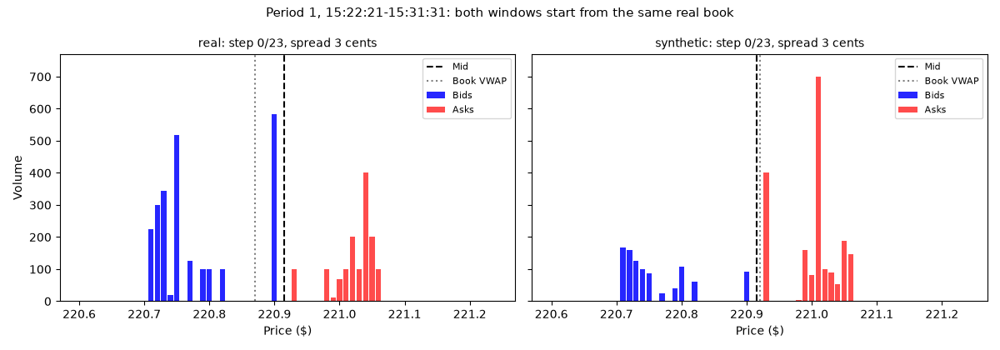
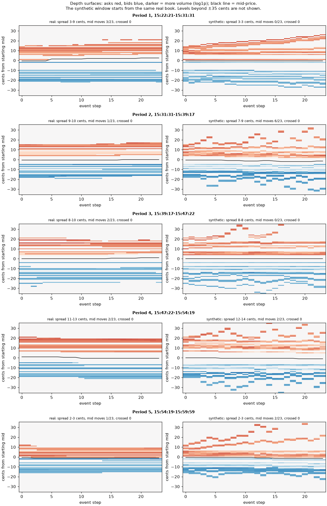

# Time-Series Generation: Limit Order Book and Market Simulation

Author: Pham Minh Duy Nguyen
Student Number: 49076750
Project 2.7 (Hard Difficulty)

## Project Goal

This project aims to generate realistic limit order books (LOBs) to support the evaluation of trading algorithms, execution strategies and risk systems. Hence, the synthetic LOBs must follow market microstructure invariants. Overall, our targets for the synthetic LOBs are:
- Valid spread
- Monotonic price ladders across levels
- Non-negative liquidity depth
- Kullback-Leibler (KL) divergence of the spread and of mid-price returns both no greater than 0.1
- Structural Similarity (SSIM) above 0.6 on 2D depth snapshots
- Realistic volatility clustering

## Files

| File | Description |
|---|---|
| `dataset.py` | Loads the LOBSTER order book, splits it chronologically (70/15/15), turns it into model features (raw, log returns, gaps or gap changes), scales them (min-max or quantile) and serves windows of 24 events, each with the real book just before it. Also decodes generated features back into order books. |
| `modules.py` | The models: TimeGAN (embedder, recovery, generator, supervisor and discriminator, all GRU networks) and the RGAN baseline. |
| `train.py` | Trains a model, validates it every 1,000 iterations, saves the best and last checkpoints, scores both on the test hours, and saves training curves, metrics and figures. |
| `predict.py` | Loads a trained checkpoint, splits the test hours into simulation periods and scores the generated books in each, with paired real and synthetic depth heatmaps and order-book GIFs. |
| `utils.py` | Metrics (crossed books, unordered levels, KL divergence, SSIM, VWAP, autocorrelation) and plots. |

## Dependencies

| Package | Version tested |
|---|---|
| Python | 3.13 |
| PyTorch | 2.14 |
| NumPy | 2.5 |
| Matplotlib | 3.11 |
| Pillow | 13.0 |
| scikit-image | 0.26 |

```bash
pip install torch numpy matplotlib pillow scikit-image
```

Training was run on Google Colab with a T4 GPU; `predict.py` runs on a CPU in seconds.

## Usage

**Data.** Download the LOBSTER sample file for AMZN on 21/06/2012 (level 10) from [here](https://php.lobsterdata.com/info/DataSamples.php) and unzip it into `datasets/LOBSTER_SampleFile_AMZN_2012-06-21_10/`, so that the order-book and message CSV files sit directly in that folder.

**Train.** `train.py` trains TimeGAN with 10,000 iterations per phase by default, about 12 minutes on a Colab T4 GPU. Results go to `--out-dir`. Each experiment below is one command:

| Experiment | Command |
|---|---|
| 1. Vanilla TimeGAN | `python train.py --out-dir outputs/e1_vanilla` |
| 2. Log returns | `python train.py --representation returns --out-dir outputs/e2a_returns` |
| 3. Log returns and validity penalty | `python train.py --representation returns --lambda-valid 1 --out-dir outputs/e2b_returns_l1` |
| 4. Quantile scaling | `python train.py --representation returns --scaling quantile --lambda-valid 1 --out-dir outputs/e2c_returns_quantile` |
| 5. Gap changes (final model) | `python train.py --representation gap_changes --out-dir outputs/e3b_gap_changes` |
| RGAN baseline | `python train.py --model rgan --representation raw --out-dir outputs/rgan_raw` |

Each run writes `best.pt` and `last.pt` (checkpoints), `val_metrics.csv`, `results.json` (test metrics and timing), `training_curves.png`, `test_distributions.png` and `test_depth.png`. Run `python train.py --help` for all options.

**Predict.** `predict.py` loads a checkpoint, generates synthetic order books in five periods of the test hours and scores them. It takes a few seconds on a CPU:

```bash
python predict.py --checkpoint outputs/e3b_gap_changes/last.pt --periods 5 --windows 1000 --gif
```

It writes `period_summary.csv` (one row per period), `period_metrics.csv` (every metric), `heatmaps.png` and, with `--gif`, one order-book GIF per period to `--out-dir` (default `outputs/predict`).

## Model Architecture

TimeGAN (Yoon et al., 2019) is a GAN for time series. Instead of generating LOB windows directly, it learns a latent space with an autoencoder (embedder and recovery) and plays the adversarial game in that space, with an extra supervised loss that teaches the generator how each step follows from the previous ones. A batch of scaled LOB windows lives in the data space $\mathcal{X} = [0, 1]^{B \times T \times d}$, with $B = 128$ windows, $T = 24$ events per window and $d = 40$ features per event. The latent space is $\mathcal{H} = [0, 1]^{B \times T \times H}$ with $H = 24$. Each network is a GRU (3 layers, 2 for the supervisor) followed by a linear layer, with 55,529 parameters in total. TimeGAN has 5 networks:
- Embedder $E: \mathcal{X} \to \mathcal{H}$: maps a LOB window $\boldsymbol{x}$ to a latent sequence $\boldsymbol{h} = E(\boldsymbol{x})$.
- Recovery $R: \mathcal{H} \to \mathcal{X}$: maps a latent sequence $\boldsymbol{h}$ back to a LOB window $\tilde{\boldsymbol{x}} = R(\boldsymbol{h})$.
- Generator $G$: maps a noise sequence $\boldsymbol{z} \in [0, 1]^{B \times T \times d}$, drawn uniformly, to a latent sequence $\hat{\boldsymbol{e}} = G(\boldsymbol{z}) \in \mathcal{H}$.
- Supervisor $S: \mathcal{H} \to \mathcal{H}$: given a latent sequence $\boldsymbol{h}$ of time $0$ to $t$, the supervisor predicts the next-step latent sequence $S(\boldsymbol{h})$ of time $1$ to $t+1$.
- Discriminator $D: \mathcal{H} \to \mathbb{R}^{B \times T}$: gives a score (logit) for each event, based on how real a latent sequence is.

TimeGAN has 3 training phases. The loss weights, the discriminator threshold and the schedule of two generator steps per discriminator step follow the authors' TensorFlow reference implementation (Yoon, 2019), reimplemented here in PyTorch:
1. Embedding: From a real LOB window $\boldsymbol{x}$, we embed it to the latent space and recover it to match the original window: $\boldsymbol{x} \to \boldsymbol{h} := E(\boldsymbol{x}) \to \tilde{\boldsymbol{x}} := R(\boldsymbol{h})$. We minimise the loss $\mathcal{L}_R = \lVert\boldsymbol{x} - \tilde{\boldsymbol{x}}\rVert^2$ and update both the embedder and the recovery.
2. Supervised: From a real LOB window $\boldsymbol{x}$, we embed it to the latent space and use the supervisor to predict the next step: $\boldsymbol{x} \to \boldsymbol{h} := E(\boldsymbol{x}) \to \boldsymbol{s} := S(\boldsymbol{h})$. We minimise

   $$\mathcal{L}_S = \frac{1}{T-1}\sum_{t=0}^{T-2}\lVert \boldsymbol{h}_{t+1} - \boldsymbol{s}_t \rVert^2,$$

   and update only the supervisor.
3. Joint: all five networks are trained together. Each iteration takes two generator and embedder steps, then one discriminator step.
   1. Generator: from a noise sequence $\boldsymbol{z}$, we generate a LOB window: $\boldsymbol{z} \to \hat{\boldsymbol{e}} := G(\boldsymbol{z}) \to \hat{\boldsymbol{h}} := S(\hat{\boldsymbol{e}}) \to \hat{\boldsymbol{x}} := R(\hat{\boldsymbol{h}})$. We minimise

      $$\mathcal{L}_G = \operatorname{BCE}\big(D(\hat{\boldsymbol{h}}), 1\big) + \gamma\,\operatorname{BCE}\big(D(\hat{\boldsymbol{e}}), 1\big) + 100\sqrt{\mathcal{L}_S} + 100\,\mathcal{L}_V,$$

      where $\operatorname{BCE}(\boldsymbol{y}, c)$ is the binary cross-entropy between the discriminator's scores $\boldsymbol{y}$ and the label vector $c\,\mathbf{1} = (c, c, \dots, c)$ of the same shape ($c = 1$ for real, $0$ for fake), and $\mathcal{L}_V$ matches the mean $\mu$ and standard deviation $\sigma$ of $\hat{\boldsymbol{x}}$ and $\boldsymbol{x}$ over the batch, for each time step $t$ and feature $f$:

      $$\mathcal{L}_V = \operatorname{mean}_{t,f}\,\lvert\hat\sigma_{t,f} - \sigma_{t,f}\rvert + \operatorname{mean}_{t,f}\,\lvert\hat\mu_{t,f} - \mu_{t,f}\rvert.$$

      We update the generator and the supervisor.
   2. Embedder: from the forward pass in step 1, we also aim to minimise $\mathcal{L}_E = 10\sqrt{\mathcal{L}_R} + 0.1\,\mathcal{L}_S$ and update the embedder and recovery, so the latent space stays both reconstructable and predictable.
   3. Discriminator: on a new real batch, we minimise

      $$\mathcal{L}_D = \operatorname{BCE}\big(D(\boldsymbol{h}), 1\big) + \operatorname{BCE}\big(D(\hat{\boldsymbol{h}}), 0\big) + \gamma\,\operatorname{BCE}\big(D(\hat{\boldsymbol{e}}), 0\big),$$

      and update the discriminator only when $\mathcal{L}_D > 0.15$, so that it does not overpower the generator.

## Dataset

LOBSTER's sample order book of Amazon (AMZN) on 21/06/2012 (LOBSTER, n.d.) was used to train the model. The dataset consists of 269,748 rows. Each row has 40 columns:
1. Level 1 ask price
2. Level 1 ask volume
3. Level 1 bid price
4. Level 1 bid volume
5. ...

No unoccupied price levels were found, so all rows of the dataset were used.

### Preprocessing

By default, all columns are scaled by a min-max scaler and the dataset is split chronologically. The first 70% of the rows are used for training, the next 15% for validation and the last 15% for testing.

## Training

To achieve most of the criteria, multiple experiments were carried out. The insights from each experiment shaped the next one. The five experiments with the main findings are discussed below. The fifth experiment is the final model, and its results are discussed in full detail in the next section.

**Setup.** All experiments use the same TimeGAN, batches of 128 windows of 24 events, Adam with learning rate $10^{-3}$, $\gamma = 1$, and 10,000 iterations per phase. Every 1,000 phase-3 iterations, the model generates 1,000 windows that are scored against the validation split; the checkpoint with the lowest validation KL of spread plus KL of returns is kept and scored once on the test split (except for the final model, see Experiment 5). Each run took 10–13 minutes on a Colab T4 GPU, with a peak of 142 MB of GPU memory.


*Losses of each training phase (top) and validation metrics during phase 3 (bottom). Experiments 2 and 3 use the same data and seed, so their phase-1 and phase-2 curves overlap; they only differ in phase 3, where experiment 3 adds the validity penalty.*

Only 10,000 iterations were run because, as the iteration count increases, the validation KLs either stop improving or get worse.


### Experiment 1: Vanilla TimeGAN

| Metric | Target (real data) | Result |
|---|---|---|
| Crossed books | 0 | 0 |
| Unordered price levels | 0 | 25.8% |
| KL spread | ≤ 0.1 (real: 0.354) | 2.572 |
| KL returns | ≤ 0.1 (real: 0.007) | 0.392 |
| SSIM, average depth | > 0.6 (real: 0.83) | 0.87 |
| Steps where the mid-price moves | 9.0% | 48.5% |
| Volume variety (synthetic / real standard deviation) | 1 | 0.22 |
| Mean mid-price | \$220.9 | \$223.4 |
| VWAP ask, mean (standard deviation) | \$221.06 (\$0.19) | \$223.54 (\$1.15) |
| VWAP bid, mean (standard deviation) | \$220.79 (\$0.17) | \$223.22 (\$1.12) |
| Autocorrelation of absolute mid-price returns, lag 1 | 0.20 | 0.28 |

Analysis:
- There is a considerable number of non-monotonic price levels.
- Neither KL spread nor KL returns reaches the target.


### Experiment 2: Log-return transformation

Recall that an original row $t$ of the dataset has the form:
$$
(\mathrm{ask}_t^{1}, \mathrm{ask\_vol}_t^{1}, \mathrm{bid}_t^{1}, \mathrm{bid\_vol}_t^{1},\dots, \mathrm{ask}_t^{10}, \mathrm{ask\_vol}_t^{10}, \mathrm{bid}_t^{10}, \mathrm{bid\_vol}_t^{10})
$$

We apply the log-return transformation to the ask and bid prices, i.e. the log of the ratio between a price and the same price one step earlier. For the volumes, we apply the log1p transformation $v \mapsto \log(1 + v)$. So a row becomes:
$$
\left(\log\frac{\mathrm{ask}_t^{1}}{\mathrm{ask}_{t-1}^{1}},\ \log(1 + \mathrm{ask\_vol}_t^{1}),\ \log\frac{\mathrm{bid}_t^{1}}{\mathrm{bid}_{t-1}^{1}},\ \log(1 + \mathrm{bid\_vol}_t^{1}),\ \dots,\ \log\frac{\mathrm{bid}_t^{10}}{\mathrm{bid}_{t-1}^{10}},\ \log(1 + \mathrm{bid\_vol}_t^{10})\right)
$$

These 40 features are then min-max scaled as before. Since returns only describe changes, a generated window is turned back into prices by starting from the real book just before the window, $\mathrm{ask}_0^k$ and $\mathrm{bid}_0^k$, and applying the generated returns step by step. Let $\hat r_s^k$ be the generated value of $\log(\mathrm{ask}_s^k / \mathrm{ask}_{s-1}^k)$. Then,
$$
\widehat{\mathrm{ask}}_t^k = \mathrm{ask}_0^k \exp\Big(\sum_{s=1}^{t} \hat r_s^k\Big),
$$
and likewise for the bids.

| Metric | Target (real data) | Result |
|---|---|---|
| Crossed books | 0 | 845 of 96,000 (0.9%) |
| Unordered price levels | 0 | 85.9% |
| KL spread | ≤ 0.1 (real: 0.354) | 0.017 |
| KL returns | ≤ 0.1 (real: 0.007) | 0.438 |
| SSIM, average depth | > 0.6 (real: 0.83) | 0.84 |
| Steps where the mid-price moves | 9.0% | 39.5% |
| Volume variety (synthetic / real standard deviation) | 1 | 0.78 |
| Mean spread | 9.7 cents | 9.7 cents |
| VWAP ask, mean (standard deviation) | \$221.06 (\$0.19) | \$221.05 (\$0.18) |
| VWAP bid, mean (standard deviation) | \$220.79 (\$0.17) | \$220.79 (\$0.17) |
| Autocorrelation of absolute mid-price returns, lag 1 | 0.20 | 0.09 |

Analysis:
- Volumes are no longer collapsed (variety 0.22 → 0.78).
- KL spread drops to 0.017, beating the real training data itself (0.354). Two things contribute: the model has learnt how the spread changes over a window, and each window starts from a real book from the test hours, so the generated spread begins at the right level.
- KL returns is still far from the goal (0.438). This is likely because the mid-price moves on 39.5% of steps instead of 9%.
- Market microstructure rules are now broken: 85.9% of snapshots have unordered levels and 0.9% of books are crossed.
- Next idea: penalise crossed books and unordered levels directly in the generator loss.

### Experiment 3: Log returns and validity penalty

We use the same transformation as Experiment 2 and add a validity penalty to the generator loss. Each generated window is decoded back into prices (in cents), and the penalty charges every crossed book and every pair of neighbouring levels less than one cent apart:
$$
\mathcal{L}_P = \operatorname{mean}_{t}\Big[\max(0,\ \mathrm{bid}_t^1 - \mathrm{ask}_t^1 + 1) + \sum_{k=1}^{9}\max(0,\ \mathrm{ask}_t^k - \mathrm{ask}_t^{k+1} + 1) + \sum_{k=1}^{9}\max(0,\ \mathrm{bid}_t^{k+1} - \mathrm{bid}_t^k + 1)\Big],
$$
averaged over the batch. A valid book has $\mathcal{L}_P = 0$. The generator now minimises $\mathcal{L}_G + \lambda\,\mathcal{L}_P$ with $\lambda = 1$.

| Metric | Target (real data) | Result |
|---|---|---|
| Crossed books | 0 | 1 of 96,000 |
| Unordered price levels | 0 | 84.4% |
| KL spread | ≤ 0.1 (real: 0.354) | 0.082 |
| KL returns | ≤ 0.1 (real: 0.007) | 0.480 |
| SSIM, average depth | > 0.6 (real: 0.83) | 0.82 |
| Mean spread | 9.7 cents | 11.3 cents |
| Steps where the mid-price moves | 9.0% | 39.7% |
| Volume variety (synthetic / real standard deviation) | 1 | 0.67 |
| VWAP ask, mean (standard deviation) | \$221.06 (\$0.19) | \$221.07 (\$0.18) |
| VWAP bid, mean (standard deviation) | \$220.79 (\$0.17) | \$220.80 (\$0.17) |
| Autocorrelation of absolute mid-price returns, lag 1 | 0.20 | 0.12 |

Analysis:
- Crossed books almost disappear (845 → 1 of 96,000).
- Unordered levels barely improve (85.9% → 84.4%), so the penalty discourages violations but cannot rule them out.
- One interesting effect of the penalty is that it pushes the best bid and ask apart, so the mean spread widens to 11.3 cents and KL spread rises to 0.082. Volume variety also drops (0.78 → 0.67).
- KL returns does not improve (0.480); the mid-price still moves on 39.7% of steps. One diagnosis is that, after scaling, the no-move value is a single precise number. So, to keep the price still, the generator has to output a value within a tiny margin around that number.
- Next idea: use a quantile scaler instead of the min-max scaler.

### Experiment 4: Quantile scaling

We use the same setup as Experiment 3 (log returns, log1p volumes and the validity penalty with $\lambda = 1$), but replace the min-max scaler with a quantile scaler. It encodes each value by its percentile among the training values, $u = \hat F(x)$, and decodes with the inverse, $x = \hat F^{-1}(u)$.

With quantile scaling, the more often a value occurs, the wider the band of outputs that decodes to it.

| Metric | Target (real data) | Result |
|---|---|---|
| Crossed books | 0 | 0 |
| Unordered price levels | 0 | 13.8% |
| KL spread | ≤ 0.1 (real: 0.354) | 0.006 |
| KL returns | ≤ 0.1 (real: 0.007) | 0.739 |
| SSIM, average depth | > 0.6 (real: 0.83) | 0.86 |
| Steps where the mid-price moves | 9.0% | 0% |
| Volume variety (synthetic / real standard deviation) | 1 | 0.77 |
| Mean spread | 9.7 cents | 9.8 cents |
| VWAP ask, mean (standard deviation) | \$221.06 (\$0.19) | \$221.06 (\$0.18) |
| VWAP bid, mean (standard deviation) | \$220.79 (\$0.17) | \$220.79 (\$0.17) |
| Autocorrelation of absolute mid-price returns, lag 1 | 0.20 | undefined (price never moves) |

Analysis:
- The price freezes: the mid-price never moves, so KL returns gets worse (0.480 → 0.739) and stays at 0.620 at every validation check.
- "No move" now fills most of the range, so the mid-price moves on 0% of steps, which is bad.
- KL spread stays low (0.006), but KL returns is worse.
- Volume variety rises (0.67 → 0.77).
- Changing the scaler alone does not fix the returns.
- Next idea: focus on generating valid books. Instead of a penalty, the validity will be enforced by construction.


### Experiment 5: Gap changes (final model)

This modification is started from the vanilla experiment. For each snapshot $t$, let $m_t = (\mathrm{ask}_t^1 + \mathrm{bid}_t^1)/2$ be the mid-price, $s_t = \mathrm{ask}_t^1 - \mathrm{bid}_t^1$ the spread, and $a_t^k = \mathrm{ask}_t^{k+1} - \mathrm{ask}_t^k$ and $b_t^k = \mathrm{bid}_t^k - \mathrm{bid}_t^{k+1}$ the gaps between neighbouring levels ($k = 1, \dots, 9$), all in cents. We define the mid-price log return $r_t$ and the change in log spread $c_t$ as
$$
r_t = \log\frac{m_t}{m_{t-1}}, \qquad c_t = \log\frac{s_t}{s_{t-1}} = \log s_t - \log s_{t-1},
$$
and treat each gap the same way as the spread. A row becomes:
$$
\left(r_t,\ c_t,\ \log\frac{a_t^1}{a_{t-1}^1},\ \dots,\ \log\frac{b_t^9}{b_{t-1}^9},\ \log(1 + \mathrm{ask\_vol}_t^1),\ \dots,\ \log(1 + \mathrm{bid\_vol}_t^{10})\right)
$$
That is 1 mid-price return, 19 changes of the log spread and log gaps, and the same 20 log1p volumes as before: 40 features, min-max scaled. No penalty is used.

A generated window is decoded from the real book just before it, as in Experiment 2: the mid-price, spread and gaps each carry on from their starting values,
$$
\hat m_t = m_0 \exp\Big(\sum_{u=1}^{t} \hat r_u\Big), \qquad \hat s_t = \max\Big(1,\ s_0 \exp\Big(\sum_{u=1}^{t} \hat c_u\Big)\Big),
$$
where $\hat r_u$ and $\hat c_u$ are the generated values of $r_u$ and $c_u$, and likewise for every gap. The book is then rebuilt level by level:
$$
\widehat{\mathrm{ask}}_t^1 = \hat m_t + \tfrac{1}{2}\hat s_t, \quad \widehat{\mathrm{bid}}_t^1 = \hat m_t - \tfrac{1}{2}\hat s_t, \quad \widehat{\mathrm{ask}}_t^{k+1} = \widehat{\mathrm{ask}}_t^k + \hat a_t^k, \quad \widehat{\mathrm{bid}}_t^{k+1} = \widehat{\mathrm{bid}}_t^k - \hat b_t^k.
$$
Since the spread and every gap are at least one cent, a generated book can never be crossed or have unordered levels.

For this model, we use the last checkpoint (iteration 10,000) instead of the one with the lowest validation KL (iteration 7,000) because, on the validation hours, the KLs are close while the last checkpoint has better volatility clustering.

| Metric | Target (real data) | Result |
|---|---|---|
| Crossed books | 0 | 0 |
| Unordered price levels | 0 | 0 |
| KL spread | ≤ 0.1 (real: 0.354) | 0.012 |
| KL returns | ≤ 0.1 (real: 0.007) | 0.213 |
| SSIM, average depth | > 0.6 (real: 0.83) | 0.81 |
| Steps where the mid-price moves | 9.0% | 11.3% |
| Volume variety (synthetic / real standard deviation) | 1 | 0.90 |
| Mean spread | 9.7 cents | 10.1 cents |
| VWAP ask, mean (standard deviation) | \$221.06 (\$0.19) | \$221.10 (\$0.24) |
| VWAP bid, mean (standard deviation) | \$220.79 (\$0.17) | \$220.78 (\$0.17) |
| Autocorrelation of absolute mid-price returns, lag 1 | 0.20 | 0.17 |

Analysis:
- No crossed books or unordered levels, by construction.
- KL returns is the lowest of all experiments (0.213, against 0.39–0.74 before), and the mid-price moves on 11.3% of steps, close to the real 9.0%. The mid is now one generated series, instead of following two best prices that each move on their own.
- KL spread passes (0.012). As in Experiment 2, this is helped by starting each window from the real spread of a test-hour book.
- Volumes are the closest to real so far (variety 0.90).
- KL returns still misses the target: the generated returns lack the rare large price jumps of the real ones.
- The full results of this model are discussed in the next section.


## Results & Discussion

The final model (Experiment 5) is benchmarked on the held-out test hours (15:22–16:00), cut into five consecutive simulation periods of about 8,100 events each. In each period, 1,000 synthetic windows are generated, each starting from a real book of that period, and compared with the 1,000 real windows that follow the same books. Real windows from the other four periods are scored the same way, as a reference for how much real periods differ from each other.

```bash
python predict.py --checkpoint outputs/e3b_gap_changes/last.pt --periods 5 --windows 1000 --gif
```



*The order book at each event step of one window in period 1: real (left) and synthetic (right), from the same starting book.*

### Heatmaps

For each period, one real window and the synthetic window grown from the same starting book are drawn as depth surfaces: price (cents from the starting mid-price) against event step, with asks in red, bids in blue, and darker meaning more volume.



In all five periods, the synthetic book keeps the overall shape of the real one. Asks stay above bids, the spread stays close to the real one, and the depth sits at similar distances from the mid-price. However, the real price levels stay in place for many steps, while the synthetic levels flicker at every step. Some deep levels, mostly on the ask side, also jump away from the mid-price for a few steps, or drift away as in period 1, as their gaps grow. The GIF shows a similar picture: the real book keeps the same volumes at most levels, while the synthetic volumes change at every step. We conclude that our model gets the shape right, but not how slowly the book changes.

### Summary

Averages over the five periods. For KL and SSIM, the real reference is the score of real windows from the other four periods; for the other rows, it is the real value.

| Metric | Target | Real reference | TimeGAN (final) | RGAN baseline |
|---|---|---|---|---|
| Crossed books | 0 | 0 | 0 of 120,000 | 0 of 120,000 |
| Unordered price levels | 0 | 0 | 0% | 100% |
| KL spread | ≤ 0.1 | 0.341 | 0.031 | 1.292 |
| KL returns | ≤ 0.1 | 0.008 | 0.227 | 2.542 |
| SSIM, average depth | > 0.6 | 0.92 | 0.78 | 0.19 |
| Autocorrelation of absolute returns, lag 1 | as real | 0.20 | 0.15 | 0.31 |
| Steps where the mid-price moves | as real | 8.9% | 11.3% | 94.0% |
| VWAP ask, standard deviation | as real | \$0.13 | \$0.19 | \$0.05 |
| VWAP bid, standard deviation | as real | \$0.12 | \$0.13 | \$0.54 |
| Volume variety (synthetic / real standard deviation) | 1 | – | 1.10 | 0.81 |
| Mean spread | as real | 9.7 cents | 10.0 cents | 23.5 cents |

The five periods' results:

| Period | Time | Crossed books | Unordered levels | KL spread (real ref) | KL returns (real ref) | SSIM, average depth (real ref) |
|---|---|---|---|---|---|---|
| 1 | 15:22:21–15:31:31 | 0 | 0.0% | 0.025 (0.328) | 0.251 (0.006) | 0.83 (0.92) |
| 2 | 15:31:31–15:39:17 | 0 | 0.0% | 0.050 (0.266) | 0.179 (0.006) | 0.81 (0.96) |
| 3 | 15:39:17–15:47:22 | 0 | 0.0% | 0.034 (0.119) | 0.206 (0.007) | 0.71 (0.92) |
| 4 | 15:47:22–15:54:19 | 0 | 0.0% | 0.032 (0.160) | 0.240 (0.005) | 0.77 (0.93) |
| 5 | 15:54:19–15:59:59 | 0 | 0.0% | 0.014 (0.834) | 0.257 (0.016) | 0.79 (0.90) |

| Period | Mid-price moves, real / synthetic | Mean spread (cents), real / synthetic | VWAP ask std, real / synthetic | Autocorrelation of absolute returns at lag 1, real / synthetic |
|---|---|---|---|---|
| 1 | 8.5% / 12.1% | 11.9 / 12.2 | \$0.13 / \$0.20 | 0.19 / 0.15 |
| 2 | 10.0% / 12.5% | 11.7 / 12.1 | \$0.15 / \$0.24 | 0.12 / 0.16 |
| 3 | 7.6% / 11.6% | 9.8 / 10.0 | \$0.11 / \$0.17 | 0.13 / 0.18 |
| 4 | 8.6% / 10.4% | 9.1 / 9.4 | \$0.16 / \$0.19 | 0.14 / 0.15 |
| 5 | 9.8% / 9.9% | 6.1 / 6.3 | \$0.09 / \$0.15 | 0.40 / 0.13 |

### Comparison with the RGAN baseline

The baseline is a plain recurrent GAN in the style of RCGAN (Esteban et al., 2017), without a condition or any transformation of the data.

```bash
python train.py --model rgan --representation raw --out-dir outputs/rgan_raw
python predict.py --checkpoint outputs/rgan_raw/best.pt --out-dir outputs/predict_rgan
```

Our final TimeGAN model is far better than the baseline:
- Despite having no crossed books, the baseline model has unordered levels in every snapshot. This is obviously far worse than our final TimeGAN with zero violations. However, our final TimeGAN uses a transformation that enforces validity, so this comparison is not entirely fair. Compared with vanilla TimeGAN, which has only about 26% unordered levels, the baseline model is still far worse.
- KL spread and returns are both worse compared to our final model.
- SSIM is also worse.
- The mid-price moves on 94% of steps, far more often than in real data and in our final model.
- The baseline also suffers from mode collapse: it generates almost the same window every time. Across 1,000 windows, its starting mid-price varies by only 0.5 cents (real: 17.6 cents) and its best-ask volume by 2 shares (real: 341), and its results are the same in every period.

Part of this lead comes from the gap-change representation, but not all of it. Vanilla TimeGAN (Experiment 1), trained on the same raw prices as the baseline, also beats it on unordered levels (26% against 100%), KL returns (0.39 against 2.55), SSIM (0.87 against 0.19) and how often the mid-price moves (49% against 94% of steps; real: 9%), on the test hours. The exception is KL spread (2.57 against 1.10). We can conclude that TimeGAN's architecture helps it learn the dynamics better, and that the representation is what makes its books valid.


### Main metrics

**Validity.** Our final TimeGAN has no crossed books and no unordered levels in all 120,000 generated snapshots. This means every synthetic book is valid: the best bid is always below the best ask, and the price levels are always in order. This is guaranteed by the gap-change representation, which rebuilds the spread and every gap as at least one cent (Experiment 5). So, for the spec's question, the model never produces crossed books.

**KL spread.** TimeGAN scores 0.014–0.050 across the five periods (average 0.031), well below the target of 0.1. This means the synthetic spreads are distributed almost like the real spreads of the same period. The real reference is much higher (0.12–0.83) because the spread changes a lot during the last 40 minutes, narrowing from about 12 to 6 cents towards the close. The model follows this change because each synthetic window starts from a real book of its period and carries on from its spread, so part of this result comes from the starting book rather than from the model alone.

**KL returns.** TimeGAN scores 0.18–0.26 across the five periods (average 0.23), above the target of 0.1. This means the distribution of mid-price returns in the synthetic windows is close, but not close enough, to the real one. As discussed in the experiments, the synthetic prices move more often than real ones (on 11% of steps against 9%), because the continuous generator struggles to output the exact no-move value.

**SSIM of depth.** TimeGAN scores 0.71–0.83 across the five periods (average 0.78), above the target of 0.6. SSIM compares the structure of two images, 1 meaning identical. Here it compares the average depth image (log volume at each of the 20 levels over the 24 steps) of real and synthetic windows. This means the model spreads volume across the levels in a pattern similar to the real book. It is still below the 0.90–0.96 that real periods score against each other, so the depth is similar but not the same, as the heatmaps also show.

**Volatility clustering.** TimeGAN scores 0.13–0.18 in autocorrelation of absolute mid-price returns at lag 1 across the five periods (average 0.15), against 0.12–0.19 in real data in the first four periods and 0.40 in the last one. This value measures whether a large price move tends to be followed by another large one. 0 would mean no clustering. This means the model does not collapse into uncorrelated noise, and its clustering matches the real one in the first four periods.

### Other statistics

**VWAP.** The average VWAP matches the real one within a few cents on both sides (ask \$221.09 against \$221.05, bid \$220.77 against \$220.79). VWAP is the volume-weighted average price of the 10 levels on one side, so it summarises where the volume sits. The bid VWAP also varies like the real one (standard deviation \$0.13 against \$0.12), while the ask VWAP varies somewhat more (\$0.15–0.24 against \$0.09–0.16). This is because some deep ask levels jump away from the mid-price, as seen in the heatmaps.

**Volume variety.** The ratio of synthetic to real volume standard deviation is 0.74–1.26 across the periods (average 1.10), close to the target of 1. This means the synthetic volumes are about as varied as real ones overall.

**Mean spread.** The synthetic mean spread follows the real one in every period, from 6.3 cents (real: 6.1) in the last period to 12.2 cents (real: 11.9) in the first. As with KL spread, this is helped by starting each window from a real book of its period.

### Compute and training stability

| | TimeGAN (final) | RGAN baseline |
|---|---|---|
| GPU | Tesla T4 (Colab) | Tesla T4 (Colab) |
| Peak GPU memory | 142 MB | 135 MB |
| Training time, 10,000 iterations per phase | 12.1 min (+ 0.4 min validation) | 3.6 min (+ 0.3 min validation) |
| Time per iteration, phases 1 / 2 / 3 | 6.8 / 5.6 / 60.2 ms | – / – / 21.9 ms (phase 3 only) |
| Generation speed, laptop CPU (Mac) | about 20,700 windows per second | about 49,400 windows per second |

Training of our final TimeGAN was stable (see the training figure in the Training section). The losses of all three phases settle, and the discriminator loss stays a little below guessing level, so the discriminator does not overpower the generator. Validation KL returns stays between 0.20 and 0.31 at every check. We use the last checkpoint (iteration 10,000), as explained in Experiment 5.

## Recommendation to the project manager

My recommendation is that the model is not yet ready to backtest trading algorithms but it is suitable for limited, structural testing.

Strengths:
- Every generated book is valid
- The spread, the overall shape of the depth and the VWAP level match the real book
- Fast generation

Limitations:
- Prices move more regularly compare to real data
- Synthetic volumes change more regularly
- The model is only trained on one day of one stock

Suggested use case: testing code that handles order books, and short scenarios of markets where the spread and the depth shape matter more than price jumps.

## Artificial Intelligence Usage Disclosure

Claude Code (Claude Opus 5.5) was used to write code, building on my first versions of `dataset.py`, `modules.py` and the training loop in `train.py`, and to draft parts of this README from the result files.

**How I verified the AI-assisted work.**
- I reviewed every change and made every commit myself, one component at a time.
- For the main metrics, I first worked out what value they should give, then checked the output against it. Some examples:
  - **When the output matched:** real books score zero crossed books, zero unordered levels and zero validity penalty. Real training hours against test hours give KL returns of 0.007 and an SSIM of 0.83.
  - **When it did not:** KL spread passes the 0.1 target even though real training hours against test hours give 0.354, which seemed impossible. I double-checked the metric function and accepted the result only once I could explain it: the starting book helps, as discussed earlier in this report.
- Every number in this README was compared with the result files (`results.json`, `val_metrics.csv` and `period_metrics.csv`).

## References

- Esteban, C., Hyland, S. L., & Rätsch, G. (2017). *Real-valued (medical) time series generation with recurrent conditional GANs*. arXiv:1706.02633. https://arxiv.org/abs/1706.02633
- LOBSTER. (n.d.). *Data samples*. https://php.lobsterdata.com/info/DataSamples.php
- Yoon, J. (2019). *TimeGAN* [Source code]. GitHub. https://github.com/jsyoon0823/TimeGAN
- Yoon, J., Jarrett, D., & van der Schaar, M. (2019). Time-series generative adversarial networks. In *Advances in Neural Information Processing Systems 32* (NeurIPS 2019). https://proceedings.neurips.cc/paper_files/paper/2019/file/c9efe5f26cd17ba6216bbe2a7d26d490-Paper.pdf

## Original Feasibility Review

### User Need, Scope & Acceptance Criteria

Intended User: Quant traders

Prototype purpose: Stress-testing execution algorithms

| Metric | Target |
|---|---|
| KL divergence, spread | ≤ 0.1 |
| KL divergence, mid-price returns | ≤ 0.1 |
| SSIM, average depth image | > 0.6 |
| SSIM, random window pairs | > 0.6 |
| Crossed books (bid ≥ ask) | 0 |
| Out-of-order price levels | 0 |
| VWAP mean, ask / bid (USD) | match real (221.1 / 220.8) |
| VWAP std, ask / bid (USD) | match real (0.188 / 0.172) |

### Model Choice & Course Concepts

Dataset: log-return transformation + Min Max scaling

Model: Vanilla TimeGAN + loss penalising invalid books

Difficulty: Hard

Reference: Yoon's paper and codebase

### Preliminary Feasibility Evidence

| Metric | Target | Real train vs test (reference) | Current progress |
|---|---|---|---|
| KL divergence, spread | ≤ 0.1 | 0.354 | **0.082** |
| KL divergence, mid-price returns | ≤ 0.1 | 0.007 | **0.480** |
| SSIM, average depth image | > 0.6 | 0.832 | **0.820** |
| Crossed books (bid ≥ ask) | 0 | 0 | **1 of 96,000** |
| Out-of-order price levels | 0 | 0 | 84% of snapshots |
| VWAP mean, ask / bid (USD) | match real (221.1 / 220.8) | 223.6 / 223.3 | **221.1 / 220.8** |
| VWAP std, ask / bid (USD) | match real (0.188 / 0.172) | 1.075 / 1.049 | **0.183 / 0.170** |

### Risks, Budget & Fallback

Key technical risk: KL returns is currently 0.48

Computing budget: Cheap. 10k iterations runs in ~10mins on T4

Next planned experiment: Figure out how to lower KL returns and ensure no cross book by construction

Fallback: At least, I'd have a model with no cross book and meet other criterias