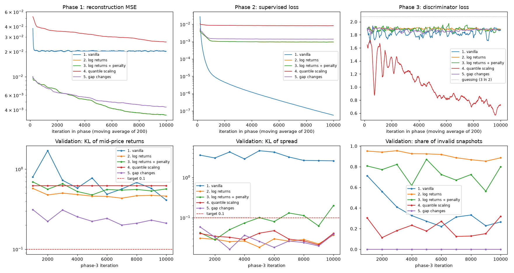

# Time-Series Generation: Limit Order Book and Market Simulation

## Project Goal

This project aim to generate realistic Limit Order Book (LOB) to support evaluation of trading algorithms, execution strategies and risk systems. Hence, the synthetic LOB is required to follow market microstructure invariants. Overall, our targets for the synthetic LOBs are:
- Valid spread
- Monotonic price ladders across levels
- Non-negative liquidity depth
- Kullback-Leibler (KL) divergence for spread and mid-price returns are both no greater than 1
- Structural Similarity (SSIM) at least 0.6 on 2D depth snapshots

## Project Structure

## Usage

## Model Architecture

TimeGAN has 5 networks
- Embedder $E$: maps a LOB window $\boldsymbol{x}$ to a latent sequence $\boldsymbol{h} = E(\boldsymbol{x})$.
- Recovery $R$: maps a latent sequence $\boldsymbol{h}$ back to a LOB window $\tilde{\boldsymbol{x}} = R(\boldsymbol{h})$.
- Generator $G$: maps a noise sequence $\boldsymbol{z}$ to a latent sequence $\hat{\boldsymbol{e}} = G(\boldsymbol{z})$.
- Supervisor $S$: given a latent sequence $\boldsymbol{h}$ of time $0$ to $t$, the supervisor predicts the next-step latent sequence $S(\boldsymbol{h})$ of time $1$ to $t+1$.
- Discriminator $D$: gives a score based on how real a latent sequence is.

TimeGAN has 3 training phases:
1. Embedding: From a real LOB window $\boldsymbol{x}$, we embed it to the latent space and recover it to match the original window: $\boldsymbol{x} \to \boldsymbol{h} := E(\boldsymbol{x}) \to \tilde{\boldsymbol{x}} := R(\boldsymbol{h})$. We aim to minimise the loss $\mathcal{L}_R = \lVert\boldsymbol{x} - \tilde{\boldsymbol{x}}\rVert^2$, and update both embedder and recovery.
2. Supervised: From a real LOB window $\boldsymbol{x}$, we embed it to the latent space and use the supervisor to predict the next step: $\boldsymbol{x} \to \boldsymbol{h} := E(\boldsymbol{x}) \to \boldsymbol{s} := S(\boldsymbol{h})$. We minimise

   $$\mathcal{L}_S = \frac{1}{T-1}\sum_{t=0}^{T-2}\lVert \boldsymbol{h}_{t+1} - \boldsymbol{s}_t \rVert^2,$$

   and update only the supervisor.
3. Joint: all five networks are trained together. Each iteration takes two generator and embedder steps, then one discriminator step.
   1. Generator: from a noise sequence $\boldsymbol{z}$, we generate a LOB window: $\boldsymbol{z} \to \hat{\boldsymbol{e}} := G(\boldsymbol{z}) \to \hat{\boldsymbol{h}} := S(\hat{\boldsymbol{e}}) \to \hat{\boldsymbol{x}} := R(\hat{\boldsymbol{h}})$. We minimise

      $$\mathcal{L}_G = \operatorname{BCE}\big(D(\hat{\boldsymbol{h}}), 1\big) + \gamma\,\operatorname{BCE}\big(D(\hat{\boldsymbol{e}}), 1\big) + 100\sqrt{\mathcal{L}_S} + 100\,\mathcal{L}_V,$$

      where $\operatorname{BCE}(\boldsymbol{y}, c)$ is the binary cross-entropy between the discriminator's scores $\boldsymbol{y}$ and the label vector $c\,\mathbf{1} = (c, c, \dots, c)$ of the same shape ($c = 1$ for real, $0$ for fake), and $\mathcal{L}_V$ matches the mean $\mu$ and standard deviation $\sigma$ of $\hat{\boldsymbol{x}}$ and $\boldsymbol{x}$ over the batch, for each time step $t$ and feature $f$:

      $$\mathcal{L}_V = \operatorname{mean}_{t,f}\,\lvert\hat\sigma_{t,f} - \sigma_{t,f}\rvert + \operatorname{mean}_{t,f}\,\lvert\hat\mu_{t,f} - \mu_{t,f}\rvert.$$

      We update the generator and the supervisor.
   2. Embedder: from the forward pass in step 1, we also aim to minimise $\mathcal{L}_E = 10\sqrt{\mathcal{L}_R} + 0.1\,\mathcal{L}_S$ and update the embedder and recovery, so the latent space stays both reconstructable and predictable.
   3. Discriminator: on a new real batch, we minimise

      $$\mathcal{L}_D = \operatorname{BCE}\big(D(\boldsymbol{h}), 1\big) + \operatorname{BCE}\big(D(\hat{\boldsymbol{h}}), 0\big) + \gamma\,\operatorname{BCE}\big(D(\hat{\boldsymbol{e}}), 0\big),$$

      and update the discriminator only when $\mathcal{L}_D > 0.15$, so that it does not overpower the generator.

## Dataset

LOBSTER's sample orderbook of AMAZON on 21/06/2012 was used to train the model. The dataset consists of 269748 rows. Each row has 40 columns, which are
1. Level 1 ask price
2. Level 1 ask volume
3. Level 2 bid price
4. Level 2 bid volume
5. ...

No unoccupied price levels were found so all rows of this dataset were fed into the model.

### Preprocessing

By default, all columns are scaled my Min Max Scaler and the dataset is splitted chronologically. The first 70\% rows are used for training. The next 15\% rows are used for validation and the last 15\% rows are used for testing.

## Training

To achieve most of the criterias, multiple experiments was carried out. Insights were collected from each experiment to reinforce the next experiment. Five experiments with main discoveries will be discussed below. The fifth experiment is the final model and its result will be discussed in full details in the next section.

**Setup.** All experiments use the same TimeGAN (five 3-layer GRU networks, hidden size 24, 55,529 parameters), batches of 128 windows of 24 events, Adam with learning rate $10^{-3}$, $\gamma = 1$, and 10,000 iterations per phase. Every 1,000 phase-3 iterations, the model generates 1,000 windows that are scored against the validation split; the checkpoint with the lowest validation KL of spread plus KL of returns is kept and scored once on the test split. Each run took 10–13 minutes on a Colab T4 GPU, with a peak of 142 MB of GPU memory.

*Losses of each training phase (top) and validation metrics during phase 3 (bottom). Experiments 2 and 3 use the same data and seed, so their phase-1 and phase-2 curves overlap; they only differ in phase 3, where experiment 3 adds the validity penalty. Phase-1 and phase-2 losses are measured on the scaled features, so experiment 4 (quantile scaling) is not directly comparable to the others on those two panels.*

Only 10000 iterations were run because:
- aaa

### Experiment 1: Vanilla TimeGAN

| Metric | Target (real data) | Result |
|---|---|---|
| Crossed books | 0 | 0 |
| Unordered price levels | 0 | 25.8% |
| KL spread | ≤ 0.1 (real: 0.354) | 2.572 |
| KL returns | ≤ 0.1 (real: 0.007) | 0.392 |
| SSIM, average depth | > 0.6 (real: 0.83) | 0.87 |
| Steps where the mid-price moves | 9.0% | 48.6% |
| Volume variety (synthetic / real standard deviation) | 1 | 0.22 |
| Mean mid-price | \$220.9 | \$223.4 |
| VWAP ask, mean (standard deviation) | \$221.06 (\$0.19) | \$223.54 (\$1.15) |
| VWAP bid, mean (standard deviation) | \$220.79 (\$0.17) | \$223.22 (\$1.12) |
| Autocorrelation of absolute mid-price returns, lag 1 | 0.20 | 0.28 |

Analysis:
- There are a considerable amount of non-monotonic price levels
- KL spread and returns both don't reach the goal

### Experiment 2: Log-return transformation

Recall that an original row $t$ of the dataset has the form:
$$
(\mathrm{ask}_t^{1}, \mathrm{ask\_vol}_t^{1}, \mathrm{bid}_t^{1}, \mathrm{bid\_vol}_t^{1},\dots, \mathrm{ask}_t^{10}, \mathrm{ask\_vol}_t^{10}, \mathrm{bid}_t^{10}, \mathrm{bid\_vol}_t^{10})
$$

We apply the log-return transformation to the ask and bid prices, i.e. the log of the ratio between a price and the same price one step earlier. For the volumes, we apply the log1p transformation $v \mapsto \log(1 + v)$. So a row becomes:
$$
\left(\log\frac{\mathrm{ask}_t^{1}}{\mathrm{ask}_{t-1}^{1}},\ \log(1 + \mathrm{ask\_vol}_t^{1}),\ \log\frac{\mathrm{bid}_t^{1}}{\mathrm{bid}_{t-1}^{1}},\ \log(1 + \mathrm{bid\_vol}_t^{1}),\ \dots,\ \log\frac{\mathrm{bid}_t^{10}}{\mathrm{bid}_{t-1}^{10}},\ \log(1 + \mathrm{bid\_vol}_t^{10})\right)
$$

These 40 features are then min-max scaled as before. Since returns only describe changes, a generated window is turned back into prices by starting from the real book just before the window, $\mathrm{ask}_0^k$ and $\mathrm{bid}_0^k$, and applying the generated returns step by step. Let $\hat r_s^k$ be the generated value of $\log(\mathrm{ask}_s^k / \mathrm{ask}_{s-1}^k)$. Then,
$$
\widehat{\mathrm{ask}}_t^k = \mathrm{ask}_0^k \exp\Big(\sum_{s=1}^{t} \hat r_s^k\Big),
$$
and likewise for the bids.

| Metric | Target (real data) | Result |
|---|---|---|
| Crossed books | 0 | 845 of 96,000 (0.9%) |
| Unordered price levels | 0 | 85.9% |
| KL spread | ≤ 0.1 (real: 0.354) | 0.017 |
| KL returns | ≤ 0.1 (real: 0.007) | 0.438 |
| SSIM, average depth | > 0.6 (real: 0.83) | 0.84 |
| Steps where the mid-price moves | 9.0% | 39.5% |
| Volume variety (synthetic / real standard deviation) | 1 | 0.78 |
| Mean spread | 9.7 cents | 9.7 cents |
| VWAP ask, mean (standard deviation) | \$221.06 (\$0.19) | \$221.05 (\$0.18) |
| VWAP bid, mean (standard deviation) | \$220.79 (\$0.17) | \$220.79 (\$0.17) |
| Autocorrelation of absolute mid-price returns, lag 1 | 0.20 | 0.09 |

Analysis:
- Volumes are no longer collapsed (variety 0.22 → 0.78).
- KL spread drops to 0.017, beating the real training data itself (0.354). Two things contribute: the model has learnt how the spread changes over a window, and each window starts from a real book from the test hours, so the generated spread begins at the right level.
- KL returns is still far from the goal (0.438). This is likely because the mid-price moves on 39.5% of steps instead of 9%.
- Market microstructures are now violated: 85.9% of snapshots have unordered levels and 0.9% of books are crossed.
- Next idea: penalise crossed books and unordered levels directly in the generator loss.

### Experiment 3: Log-returns & validity penalty

We use the same transformation as Experiment 2 and add a validity penalty to the generator loss. Each generated window is decoded back into prices (in cents), and the penalty charges every crossed book and every pair of neighbouring levels less than one cent apart:
$$
\mathcal{L}_P = \operatorname{mean}_{t}\Big[\max(0,\ \mathrm{bid}_t^1 - \mathrm{ask}_t^1 + 1) + \sum_{k=1}^{9}\max(0,\ \mathrm{ask}_t^k - \mathrm{ask}_t^{k+1} + 1) + \sum_{k=1}^{9}\max(0,\ \mathrm{bid}_t^{k+1} - \mathrm{bid}_t^k + 1)\Big],
$$
averaged over the batch. A valid book has $\mathcal{L}_P = 0$. The generator now minimises $\mathcal{L}_G + \lambda\,\mathcal{L}_P$ with $\lambda = 1$.

| Metric | Target (real data) | Result |
|---|---|---|
| Crossed books | 0 | 1 of 96,000 |
| Unordered price levels | 0 | 84.4% |
| KL spread | ≤ 0.1 (real: 0.354) | 0.082 |
| KL returns | ≤ 0.1 (real: 0.007) | 0.480 |
| SSIM, average depth | > 0.6 (real: 0.83) | 0.82 |
| Mean spread | 9.7 cents | 11.3 cents |
| Steps where the mid-price moves | 9.0% | 39.7% |
| Volume variety (synthetic / real standard deviation) | 1 | 0.67 |
| VWAP ask, mean (standard deviation) | \$221.06 (\$0.19) | \$221.07 (\$0.18) |
| VWAP bid, mean (standard deviation) | \$220.79 (\$0.17) | \$220.80 (\$0.17) |
| Autocorrelation of absolute mid-price returns, lag 1 | 0.20 | 0.12 |

Analysis:
- Crossed books almost disappear (845 → 1 of 96,000).
- Unordered levels barely improve (85.9% → 84.4%) so penalty discourages violations but it cannot rule them out.
- One interesting effect of the penalty is it pushes the best bid and ask apart, so the mean spread widens to 11.3 cents and KL spread rises to 0.082. Volume variety also drops (0.78 → 0.67).
- KL returns does not improve (0.480); the mid-price still moves on 39.7% of steps. One diagnosis is that the no-move value after scaled is a precise number. So to not move the price, the generator has to generate precisely in a small margin of error to round to that exact number.
- Next idea: use Quantile Scaler instead of Min Max Scaler

### Experiment 4: Quantile scaling

We use the same setup as Experiment 3 (log returns, log1p volumes and the validity penalty with $\lambda = 1$), but replace the min-max scaler with a quantile scaler. It encodes each value by its percentile among the training values, $u = \hat F(x)$, and decodes with the inverse, $x = \hat F^{-1}(u)$.

With quantile scaling, the more often a value occurs, the wider the band of outputs that decodes to it.

| Metric | Target (real data) | Result |
|---|---|---|
| Crossed books | 0 | 0 |
| Unordered price levels | 0 | 13.8% |
| KL spread | ≤ 0.1 (real: 0.354) | 0.006 |
| KL returns | ≤ 0.1 (real: 0.007) | 0.739 |
| SSIM, average depth | > 0.6 (real: 0.83) | 0.86 |
| Steps where the mid-price moves | 9.0% | 0% |
| Volume variety (synthetic / real standard deviation) | 1 | 0.77 |
| Mean spread | 9.7 cents | 9.8 cents |
| VWAP ask, mean (standard deviation) | \$221.06 (\$0.19) | \$221.06 (\$0.18) |
| VWAP bid, mean (standard deviation) | \$220.79 (\$0.17) | \$220.79 (\$0.17) |
| Autocorrelation of absolute mid-price returns, lag 1 | 0.20 | undefined (price never moves) |

Analysis:
- The price freezes: the mid-price never moves, so KL returns gets worse (0.480 → 0.739) and stayed at 0.620 on every validation check.
- "No move" now fills most of the range, so Steps where mid-prices moves account for 0% now, which is bad.
- KL spread is as good as before. KL returns is worse.
- Volume variety rises (0.67 → 0.77).
- Changing the scaler alone does not fix the returns.
- Next idea: focus on generating valid books. Instead of a penalty, the validity will be enforced by construction.

### Experiment 5: Gap changes (final model)

This modification is started from the vanilla experiment. For each snapshot $t$, let $m_t = (\mathrm{ask}_t^1 + \mathrm{bid}_t^1)/2$ be the mid-price, $s_t = \mathrm{ask}_t^1 - \mathrm{bid}_t^1$ the spread, and $a_t^k = \mathrm{ask}_t^{k+1} - \mathrm{ask}_t^k$ and $b_t^k = \mathrm{bid}_t^k - \mathrm{bid}_t^{k+1}$ the gaps between neighbouring levels ($k = 1, \dots, 9$), all in cents. We define the mid-price log return $r_t$ and the change in log spread $c_t$ as
$$
r_t = \log\frac{m_t}{m_{t-1}}, \qquad c_t = \log\frac{s_t}{s_{t-1}} = \log s_t - \log s_{t-1},
$$
and treat each gap the same way as the spread. A row becomes:
$$
\left(r_t,\ c_t,\ \log\frac{a_t^1}{a_{t-1}^1},\ \dots,\ \log\frac{b_t^9}{b_{t-1}^9},\ \log(1 + \mathrm{ask\_vol}_t^1),\ \dots,\ \log(1 + \mathrm{bid\_vol}_t^{10})\right)
$$
That is 1 mid-price return, 19 changes of the log spread and log gaps, and the same 20 log1p volumes as before: 40 features, min-max scaled. No penalty is used.

A generated window is decoded from the real book just before it, as in Experiment 2: the mid-price, spread and gaps each carry on from their starting values,
$$
\hat m_t = m_0 \exp\Big(\sum_{u=1}^{t} \hat r_u\Big), \qquad \hat s_t = \max\Big(1,\ s_0 \exp\Big(\sum_{u=1}^{t} \hat c_u\Big)\Big),
$$
where $\hat r_u$ and $\hat c_u$ are the generated values of $r_u$ and $c_u$, and likewise for every gap. The book is then rebuilt level by level:
$$
\widehat{\mathrm{ask}}_t^1 = \hat m_t + \tfrac{1}{2}\hat s_t, \quad \widehat{\mathrm{bid}}_t^1 = \hat m_t - \tfrac{1}{2}\hat s_t, \quad \widehat{\mathrm{ask}}_t^{k+1} = \widehat{\mathrm{ask}}_t^k + \hat a_t^k, \quad \widehat{\mathrm{bid}}_t^{k+1} = \widehat{\mathrm{bid}}_t^k - \hat b_t^k.
$$
Since the spread and every gap are at least one cent, a generated book can never be crossed or have unordered levels.

| Metric | Target (real data) | Result |
|---|---|---|
| Crossed books | 0 | 0 |
| Unordered price levels | 0 | 0 |
| KL spread | ≤ 0.1 (real: 0.354) | 0.009 |
| KL returns | ≤ 0.1 (real: 0.007) | 0.187 |
| SSIM, average depth | > 0.6 (real: 0.83) | 0.88 |
| Steps where the mid-price moves | 9.0% | 14.9% |
| Volume variety (synthetic / real standard deviation) | 1 | 0.84 |
| Mean spread | 9.7 cents | 10.1 cents |
| VWAP ask, mean (standard deviation) | \$221.06 (\$0.19) | \$221.10 (\$0.69) |
| VWAP bid, mean (standard deviation) | \$220.79 (\$0.17) | \$220.78 (\$0.17) |
| Autocorrelation of absolute mid-price returns, lag 1 | 0.20 | 0.41 |

Analysis:
- No crossed books or unordered levels, by construction.
- KL returns is the lowest of all experiments (0.187, against 0.39–0.73 before), and the mid-price moves on 14.9% of steps, close to the real 9.0%. The mid is now one generated series, instead of following two best prices that each move on their own.
- KL spread passes (0.009). As in Experiment 2, this is helped by starting each window from the real spread of a test-hour book.
- Volumes are the closest to real so far (variety 0.84).
- KL returns still misses the target: the generated returns lack the rare large price jumps of the real ones.
- The full results of this model are discussed in the next section.

## Results & Discussion